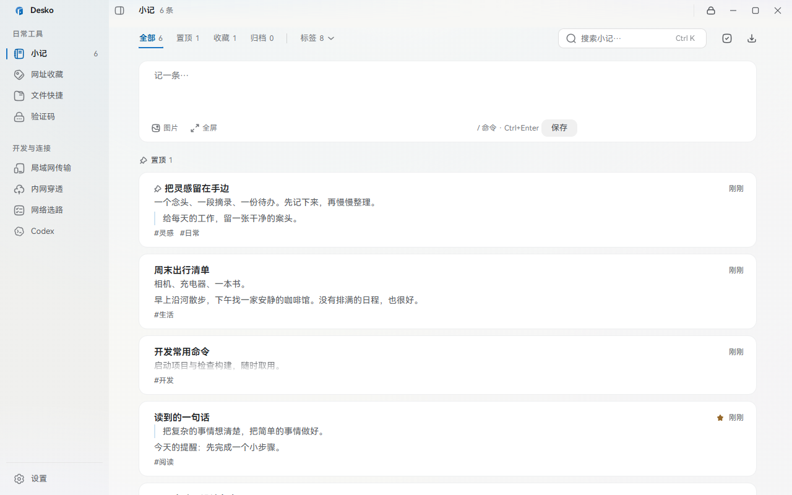
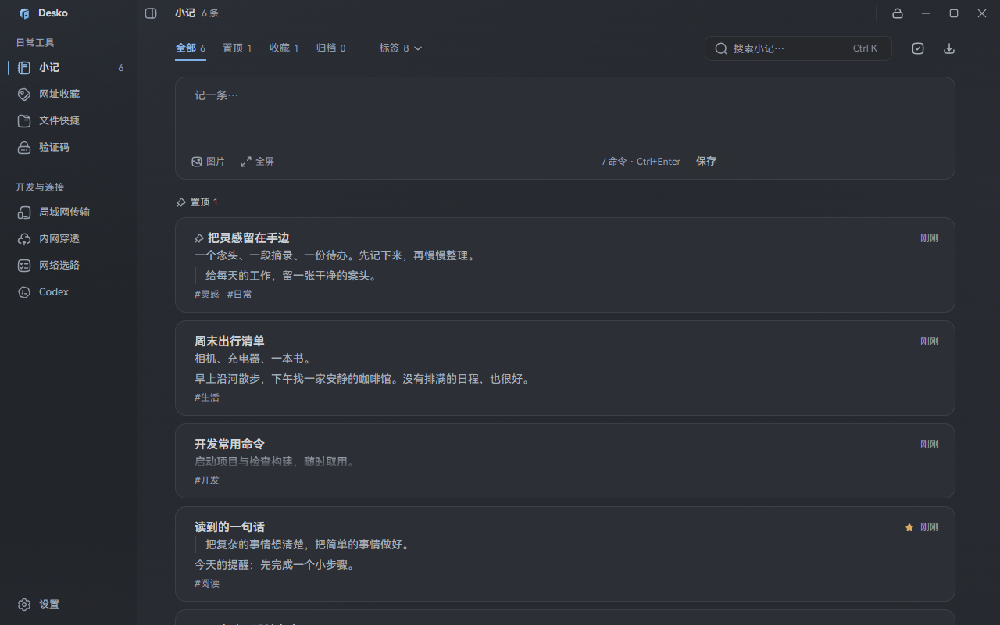
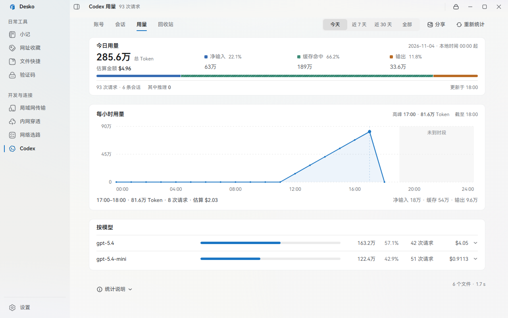
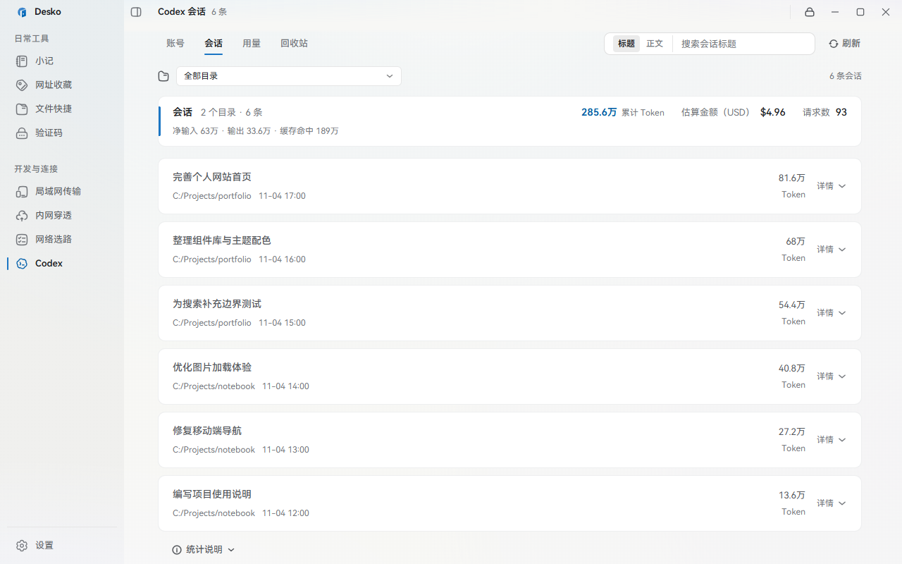
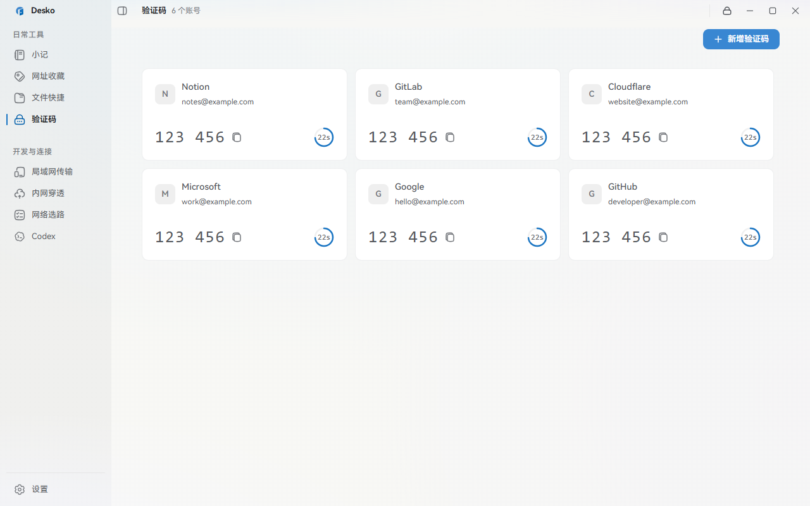

<div align="center">

# Desko · 案头

**把常用的东西，放回手边。**

小记、网址、文件、验证码，还有你的 Codex 工作记录。
一个 Windows 桌面工作台，收好每天用得到的零碎。

[认识 Desko](#一个窗口接住日常工作) · [开始使用](#开始使用) · [开发与构建](docs/development.md) · [反馈问题](https://github.com/jxiaow/desko/issues)

</div>



## 一个窗口，接住日常工作

刚想到的点子，散落在便签里；常用网址，埋在浏览器里；项目目录，每天都要重新找一遍。用 Codex 做完一轮工作，还想回头看看聊过什么、用了多少 Token。

Desko 把这些高频的小事放到一张「案头」上。打开它，记下一段话，取一个验证码，找到上次的会话，然后继续手头的工作。

- **只留下你需要的工具。** 八个模块按需开启。可以从小记和收藏开始，再慢慢搭出自己的工作台。
- **本地优先。** 工作区数据保存在本机；WebDAV 备份和浏览器访问由你自行开启。
- **照顾长时间使用。** 「纸」与「墨」两套外观，搭配多种强调色和可开关的背景氛围。
- **让电脑上的资料随手可用。** 开启 Web 访问后，手机和其他电脑也能通过浏览器使用支持的模块。

## 随手记，也能认真整理

小记适合记录一个念头，也装得下一份项目备忘。富文本、图片、代码块与待办放在一起；用标签整理、用置顶留住近期重点，做完的内容可以归档。

从网页粘贴内容时，可以选择只粘贴文本，减少杂乱格式。需要保护的内容，还可以使用小记口令加密。

<details>
<summary>看看「墨」色外观</summary>



</details>

## 给 Codex 工作留一份清楚的记录

多账号切换、历史会话、用量统计，集中在一个模块里。

- **账号：** 管理多个账号，查看配额，按需切换；桌面额度挂件让剩余额度更容易看到。
- **会话：** 按项目目录筛选，按标题或正文搜索，在列表内展开详情；支持移入回收站与恢复，也能按目录批量清理会话。
- **用量：** 查看今天、近 7 天、近 30 天或全部记录的 Token 用量、趋势与模型排行，还能生成分享图片。



<details>
<summary>看看会话列表</summary>



</details>

用量来自本机会话记录；界面中的金额为估算值，不是服务商账单。Codex 模块用于管理账号、会话和用量，不提供内置 AI 对话界面。

## 常用工具，各就各位

| 模块 | 什么时候用得上 |
| --- | --- |
| **小记** | 随手记灵感，整理项目备忘、摘录和待办。 |
| **网址收藏** | 收藏常用站点，连同账号信息一起管理，用标签快速找回。 |
| **文件快捷** | 把常用文件和项目目录放到手边，一键打开文件、目录或终端。 |
| **验证码** | 集中查看与复制 TOTP 动态码，支持二维码导入。 |
| **局域网传输** | 同一网络里的设备通过浏览器互传文件。 |
| **内网穿透** | 通过 Cloudflare 隧道，为本机服务配置公网访问入口。 |
| **网络选路** | 按不同域名探测连接，选择合适的网卡出口，并应用所需的 hosts 与路由配置。 |
| **Codex** | 管理账号与配额，检索会话，查看用量和模型排行。 |



网络选路涉及系统配置，应用时需要 Windows 管理员授权。内网穿透需要相应的 Cloudflare 配置。

## 从桌面，延伸到浏览器

在「设置 → Web 访问」启动服务后，可在浏览器里登录当前工作区。需要手机访问时，开启局域网访问，打开页面提供的地址即可。

浏览器支持小记、网址收藏、文件快捷、验证码、Codex、局域网传输和内网穿透。文件快捷可以浏览和下载电脑上已收藏的内容；添加本机路径、打开终端等操作仍在桌面完成。

Web 服务由桌面端运行，退出 Desko 后停止。局域网访问使用 HTTP，适合可信网络。具体能力和登录方式见 [Web 访问说明](docs/web-access.md)。

## 开始使用

Desko 面向 **Windows 10 / 11**，需要 WebView2 运行时。

可在 [Releases](https://github.com/jxiaow/desko/releases) 下载已发布的安装包，也可以从源码运行或自行构建安装包。

准备 Node.js（`^20.19.0 || ^22.12.0 || >=24.0.0`）、Rust 稳定版、MSVC 构建工具与 Windows SDK，然后在 Windows 终端执行：

```powershell
git clone https://github.com/jxiaow/desko.git
cd desko
npm install
npm run tauri dev
```

首次打开时，按引导设置主密码，选择需要的模块，点击「进入工作台」。之后可以在设置里调整模块和外观。

自行生成 Windows 安装包：

```powershell
npm run build:installer
```

安装包输出到 `installer/`。维护者可运行 `npm run release` 发起 GitHub 多平台打包，见 [发布说明](docs/release.md)。环境配置、常用命令和排错方法见 [开发与构建](docs/development.md)。

## 数据由你保管

Desko 使用本地档案保存工作区数据，支持主密码锁定和多档案。数据默认位于 `%APPDATA%\com.desko.app\profiles\<档案 id>\`。

在「设置 → 数据与备份」可以生成备份，也可以自行配置 WebDAV 备份。恢复备份需要备份密码；更换设备前，建议先导出并确认备份可用。

本地优先并不代表所有功能都离线：Codex 授权和配额查询、Cloudflare 隧道、网络探测、WebDAV 等功能需要相应的网络服务。

## 一起把案头整理得更好

遇到问题或有想法，欢迎提交 [Issue](https://github.com/jxiaow/desko/issues)。描述使用场景、复现步骤和预期效果，会更方便定位；分享截图或日志前，请隐去个人信息。

想参与开发，可以从 [开发文档](docs/development.md) 和 [设计记录](docs/design/) 开始。项目采用 Tauri 2、Rust、Vue 3 与 TypeScript。

本文截图来自实际前端界面，使用隔离的演示数据，不包含真实账号、密钥或个人会话。截图复现方式见 [截图说明](docs/images/README.md)。字体与图标的许可和致谢分别见 [字体说明](public/fonts/NOTICE.md)、[图标说明](public/icons/NOTICE.md)。
