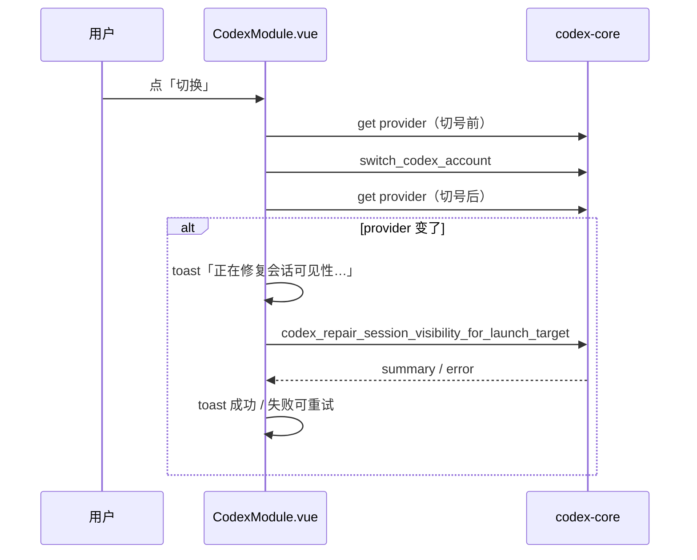

# Codex 切号收尾：会话可见性修复（设计稿 · 已实现 2026-10-10）

配套 `01-plan.md`（rev4，账号管理+切号已交付；本次为 rev5 增补）。本文只补一件事：**切号后会话在官方 Codex 侧边栏消失**的自愈。范围见「移植清单」。

实现结论速览：按 §4 清单**整文件照搬**，`backup_storage.rs`（1570 行）整搬一次过、未退抽取（§5-B 关闭）；新增 2 条命令，在册命令 59 → 61；触发在前端切号收尾，判据取 `model_provider`（§5 三项均已按建议落地）。

## 1. 问题与目标

desko 的切号投影（`codex_account_projection.rs`，与上游逐字节一致）在切成 API Key 账号时会写 `config.toml` 的 `model_provider`（`write_api_key_runtime_provider_to_config_toml`），切成 OAuth 账号时写 `forced_login_method`。官方 Codex 侧边栏按 `model_provider` 过滤 `threads`，于是**凭据形态一变（OAuth ↔ API Key / API 模式），旧会话记录就整批不显示**。

上游对此的自愈就是本模块。目标：把这个自愈补进 desko，行为与上游一致，不做二次发明。

> 注：`01-plan.md` 的「不进 desko 的上游能力」清单没列这一项，它是随「多实例域」被顺带切掉的（上游把会话命令放在 `codex_instance.rs`）。本次补回后需在 `01-plan.md` 补一行说明。

## 2. 上游机制还原（本次核验结论）

上游**不在切号后端里顺手修**。`codex_account_commands.rs:647` 的 `repair_codex_session_visibility_after_credential_kind_change` 只做一件事：比较切号前后的凭据快照，`kind` 变了就打日志「defer quick repair to frontend notice」并把收尾交给前端提示（`codex.apiSwitchNotice.*`）。真正的修复由前端调用 `codex_repair_session_visibility_across_instances`（quick 模式）触发。

**quick 模式改什么**（`CodexSessionVisibilityRepairOptions::official_state_db_only`，`sidebar_visible_only: true`，`require_stopped_instances: false`）：

| 目标 | 动作 |
|---|---|
| 官方 state DB（`<CODEX_HOME>/sqlite/state_5.sqlite`、`codex-dev.db`） | `UPDATE threads SET model_provider = ?` + 修空 `cwd` / 补 `preview`、`has_user_event`、`thread_source` |
| 被 state DB 引用的 rollout（`sessions/`、`archived_sessions/*.jsonl`） | 改写 `session_meta` 的 `model_provider`，并把 mtime 对齐 session_index |
| 前置 | 改前自动备份（rollout + sqlite），只保留 1 份（`backup-<ts>-session-visibility-repair`） |

`target_provider` = `<CODEX_HOME>/config.toml` 的 `model_provider`，缺省 `"openai"`（`read_target_provider`）。**全程只碰本地文件，零网络请求**——与封号无关。

desko 侧 `get_codex_home()` = `CODEX_HOME` 或 `~/.codex`，即用户真实的官方目录；修复改的就是这份数据。

## 3. 触发设计（desko 版）

上游的做法是「后端只记日志、前端收口」。desko 照抄这个形状，但用一个**更贴近真实成因**的判据：既然侧边栏过滤键与修复目标键都是 `model_provider`，就直接比较它。

- 切号完成后，前端取一次当前 `model_provider`；与切号前缓存的值不同 → 调修复命令 + toast。
- 失败不阻断切号（切号本身已成功），toast 提示可重试。
- 不做后台自动重试、不做定时任务。

**被否的方案**：在 `switch_codex_account` 内部同步修复。理由——(a) 上游明确把这一步甩给前端提示，后端内联是新的偏差；(b) 修官方 state DB 可能耗时且会因 DB 被占用失败，混进切号事务会把「切成功但提示失败」搅在一起；(c) 要在 keeper 文件里搬 `CodexLaunchCredentialSnapshot` 整簇（desko 已删），改动面比新增两个只读/只写命令大得多。

## 4. 移植清单

除「差异」列注明外，一律**逐字节取自上游 `be24ce6`(v1.3.66) 并 CRLF 归一**，与 `01-plan.md` 的 promote 规则一致。

| # | 文件（`src-tauri/codex-core/src/modules/`） | 上游行数 | 处置 |
|---|---|---|---|
| 1 | `codex_session_visibility.rs` | 13 | 替换现有**空桩**；聚合 `include!`，去掉 `#[cfg(test)]` 测试 include |
| 2 | `codex_session_visibility_repair_api.rs` | 1593 | 逐字节 |
| 3 | `codex_session_visibility_sqlite_repair.rs` | 1109 | 逐字节 |
| 4 | `codex_session_visibility_catalog.rs` | 972 | 逐字节 |
| 5 | `codex_session_visibility_instance_discovery.rs` | 1017 | 逐字节（多实例入口保留但不可达，见 §6） |
| 6 | `codex_session_visibility_backup.rs` | 642 | 逐字节 |
| 7 | `codex_session_file_time.rs` | 94 | 逐字节（新依赖） |
| 8 | `backup_storage.rs` | 1570 | 逐字节（**整搬成功**，未退 §5-B 的抽取方案） |
| 9 | `db.rs` | 382 → 抽 14 行 | **仅抽 `is_unusable_sqlite_database_error` + `_message`**（纯字符串/错误码判定） |
| 10 | `codex_official_app_server.rs` | 962 → 桩 | 只留 `rebuild_thread_metadata`，返 `Err`（deep 路径专用，quick 不达；调用方 `try_rebuild_thread_metadata` 只记日志返 bool，被 `?` 传播无风险） |

新增/复用 desko 侧（非上游文件）：

| 位置 | 内容 |
|---|---|
| `codex-core/Cargo.toml` | 加 `rusqlite = { version = "0.31", features = ["bundled", "backup"] }` |
| `codex-core/src/commands/codex.rs` | 新增 2 条命令：`get_codex_history_visibility_provider`（读 `model_provider`）、`codex_repair_session_visibility_for_launch_target`（`repair_session_visibility_quick_for_instance("__default__", "默认实例", &codex_home)`） |
| `src-tauri/src/main.rs` | `generate_handler!` 注册上述 2 条 → **在册命令 59 → 61** |
| `src/services/api/codex.ts`、`CodexModule.vue` | 切号前后取 provider、变更时调修复并 toast；沿用宿主 28px 动作档与既有 toast |

复用到的 desko 现有桩（无需改）：`process::collect_codex_process_entries` 返空、`process::resolve_codex_pid_from_entries` 返 `None` —— 等价于上游「没有受控 Codex 运行时」，quick 路径语义正确。

## 5. 拍板结论（原「待拍板项」，已于 2026-10-10 落地）

- **B. `backup_storage.rs` 怎么进** → **整搬**。1570 行逐字节照拷后 `cargo check -p codex-core` 一次过：它的 `use crate::modules::{account, codex_account, codex_instance, config}` 在 desko 侧同名模块都存在（哪怕是桩），`test_support` 只在 `#[cfg(test)]` 里引用，非测试编译不受影响。**未退回抽取方案，§6 不新增差异条目。**
- **C. 是否顺带补「会话管理」页** → **不补**。只补自愈；会话列表/用量/回收站/导入导出是独立产品面（上游 3 个前端组件 + ~20 条命令 + 6 个模块）。
- **触发判据** → **用 `model_provider`**，不复刻上游的「凭据 kind 快照」。它就是要修的那个键本身（官方侧栏按它过滤 `threads`），且不必复活已删的快照簇。

## 6. 与上游的差异（全部显式登记）

1. `db.rs` 只抽 1 个纯函数，不整搬（避免拖入 `antigravity_paths` → `data_paths` 门面 + Token 注入机制）。
2. 各文件 `#[cfg(test)]` 测试 include 按 `01-plan.md` 惯例丢弃 → **本模块无单测**，靠 e2e + 真机验收（见 §8）；上游 `codex_session_visibility_tests.rs`（1312 行）不落地。
3. `codex_official_app_server::rebuild_thread_metadata` 为桩；不可达（quick 的 `rebuild_metadata: false`）。
4. 命令面 59 → 61（新增 2 条），`01-plan.md` 的 D10 名单需同步。
5. `instance_discovery.rs` 里的 `collect_instances()` 会调 `codex_instance::load_instance_store()`（desko 桩返 `Err`）→ 多实例入口全部不可达，仅保证编译。

## 7. 风险

- **会写用户真实的官方 Codex 数据**（`~/.codex` 的 state DB 与 rollout）。缓解：上游自带的改前备份（仅留 1 份）；只改 `model_provider`/空 `cwd` 等展示字段，不动会话正文。
- **官方 Codex 正在运行时会失败**（`database is locked`），错误信息已是「请关闭 Codex / Codex App 后重试」，与页面既有「切换前先退出 Codex 客户端」一致。不重试、不代用户关进程。
- **无单测覆盖**（测试 include 丢弃）→ 真机验收是主判据。
- ~~`backup_storage.rs` 整搬若编译不过，退到抽取方案~~ → 已整搬成功，风险关闭。
- 无封号向风险：全路径无网络请求。

## 8. 验收

### 实测（2026-10-10）

1. `cargo check -p codex-core` 0 error；`cargo check -p desko --all-targets` 0 error；`cargo build` exit 0；唯一警告 `codex_account_projection.rs:240` 的 `unreachable expression`（与上游同形，不改）。编译对账结果：§4 清单里所有被引用的跨模块符号均已存在，**无新增缺口**，§6 未新增条目。
2. `npx vue-tsc --noEmit` 0；`npx vitest run` **200/200**；`PW_CHANNEL=msedge npx playwright test specs/codex.spec.ts` **13/13**——新增两条：「换凭据形态切号 → 修一次」（断言 `get_codex_history_visibility_provider` 恰 2 次、修复命令 1 次）、「修复失败只降级成 error toast，切号仍生效」；既有切号用例补了「同形态不修」（修复命令 0 次）断言。
3. 注册表对账：`#[tauri::command]` 定义数 = `main.rs` 注册数 = `keep_cmds.json` 在册数 = **61**；`cargo test -p desko --bin desko gate_tests` 2/2 通过。
4. 截图（`shots/`，gitignore 内）：`codex-repair-info` / `codex-repair-ok` / `codex-repair-fail`（全窗）+ 同名 `-toast.png`（toast 特写）。

### 仍待真机（唯一硬判据）

5. 在 OAuth 账号与 API Key 账号之间来回切 → 每次切完开官方 Codex，确认历史会话仍在侧边栏；确认 `<desko 档案目录>/codex/` 数据目录下出现 `backup-*-session-visibility-repair` 目录；官方 Codex 开着时切号应看到「请关闭 Codex」类失败提示且切号本身仍成功。
