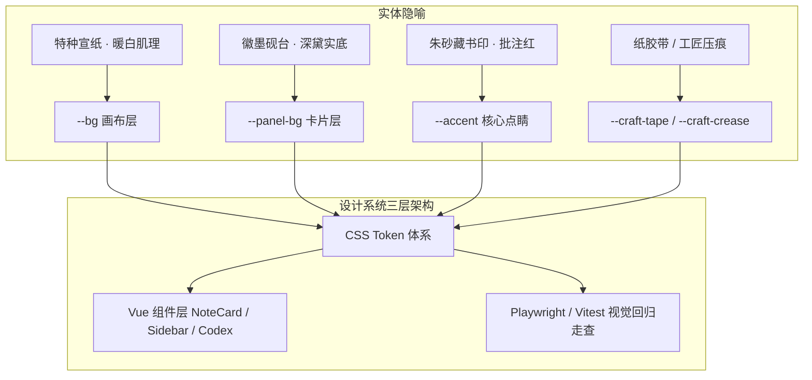

# Desko · 案头「文房工匠 (Desko Craft)」全量设计系统与 Token 架构规范

本规范为「文房工匠」视觉重构的**终版技术施工标准**。定义了从物理隐喻、语义层到代码层 Token 的 1:1 精确映射，确保在不破坏既有组件 API、不引发样式断言回归的前提下完成蜕变。

---

## 一、 整体设计架构与隐喻映射



---

## 二、 完整色彩与语义 Token 映射清单 (Token Registry)

### 1. 宣纸白 (Paper Light) 全量 Token 字典

| CSS 变量名 | 当前基线值 | **文房工匠重构值** | WCAG 对比度 / L* 说明 | 业务落地位置 |
| :--- | :--- | :--- | :--- | :--- |
| `--bg` | `#fafafa` | **`#faf8f5`** | 宣纸暖白，略带天然特种纸暖灰倾向，L* 97.4 | 工作台主画布背景 |
| `--workspace-frame` | `#f0f0f0` | **`#eae5de`** | 案头桌沿实木底衬，L* 91.2，拉开窗体层次 | 桌面外壳边框底色 |
| `--sidebar-bg` | `#fafafa` | **`#f3efe8`** | 导轨暖色切口，L* 94.6，与主画布自然沉降 | 侧边栏导航底 |
| `--panel-bg` | `#ffffff` | **`#ffffff`** | 纯净纸面，L* 100，与画布对比度 1.15:1 形成柔和抬升 | 卡片、弹层、输入面板 |
| `--sunken` | `#f5f5f5` | **`#f2ede4`** | 凹槽微阴影底，L* 93.8 | 代码块槽、引用块、搜索槽 |
| `--fill` | `#f0f0f0` | **`#ece6dc`** | 控件静息底，L* 91.5 | 胶囊按钮、筛选标签底 |
| `--hover` | `#f3f3f3` | **`#f0ebe2`** | 鼠标滑过微温润响应 | 菜单、按钮 hover 态 |
| `--active` | `#ececec` | **`#e7e0d4`** | 点击物理下压态 | 按下态 |
| `--border` | `#e6e6e6` | **`#e4ded4`** | 古籍切口暖线，消除冷蓝冷灰 | 面板、常规边框 |
| `--border-strong` | `#cfcfcf` | **`#d4ccbf`** | 深一档物理分割线 | 窗体切分、激活线 |
| `--border-subtle` | `#f0f0f0` | **`#ece6dc`** | 极弱分隔线 | 列表分割线 |
| `--card-line-soft` | `rgba(15,23,42,0.07)` | **`rgba(80,68,55,0.08)`** | 纸质微纤维暗边，带暖棕倾向 | 卡片发丝线 |
| `--card-line-strong`| `rgba(15,23,42,0.12)` | **`rgba(80,68,55,0.16)`** | 悬停强化边 | 卡片 hover 边 |
| `--text` | `#1f2023` | **`#232220`** | 浓墨字色，对白卡对比度 **15.6:1** (AAA) | 主标题、正文 |
| `--text-secondary` | `#55585d` | **`#57534e`** | 焦墨副色，对白卡对比度 **7.8:1** (AAA) | 次级说明、列表正文 |
| `--text-muted` | `#74777c` | **`#736d65`** | 烟墨辅助，对白卡对比度 **5.9:1** (符合本仓≥5.8硬底线) | 时间戳、字数、副标签 |
| `--text-faint` | `#8c8f94` | **`#8c857b`** | 极淡提示，对白卡对比度 **3.6:1** | 占位符、UUID |
| `--accent` (默认朱砂) | `#1b76c4` (原蓝) | **`#ba4b47`** | 传统朱砂红印章色，对白卡 **5.4:1** 纯正典雅 | 选中高亮、首选按钮 |
| `--accent-soft` | `color-mix(...)` | **`rgba(186, 75, 71, 0.12)`** | 印泥微印衬底 | 状态标签、徽章背景 |
| `--accent-ring` | `color-mix(...)` | **`rgba(186, 75, 71, 0.24)`** | 焦点朱砂光晕 | 焦点轮廓聚焦环 |

---

### 2. 玄墨底 (Ink Dark) 全量 Token 字典

| CSS 变量名 | 当前基线值 | **文房工匠重构值** | WCAG 对比度 / L* 说明 | 业务落地位置 |
| :--- | :--- | :--- | :--- | :--- |
| `--bg` | `#141517` | **`#16171a`** | 徽墨黑，L* 8.8，沉静中性偏黛色 | 工作台主画布背景 |
| `--workspace-frame` | `#101113` | **`#0f1012`** | 桌角深影底衬，L* 5.9 | 桌面外壳边框底色 |
| `--sidebar-bg` | `#101113` | **`#131416`** | 侧栏导轨深黛底，L* 7.2 | 侧边栏导航底 |
| `--panel-bg` | `#1f2124` | **`#1c1d21`** | 黑石砚台质感，L* 11.4 | 卡片、浮动面板 |
| `--sunken` | `#0f1012` | **`#121315`** | 凹槽暗底，L* 6.8 | 代码槽、搜索槽 |
| `--fill` | `#26282c` | **`#24262b`** | 控件底色 | 胶囊按钮、标签底 |
| `--hover` | `#2a2d31` | **`#2a2c32`** | 鼠标悬停提亮 | 菜单悬停 |
| `--active` | `#303338` | **`#32353c`** | 物理下压响应 | 按下态 |
| `--border` | `#33363c` | **`#282a2f`** | 砚台发丝线，严控边框噪声 | 常规边框 |
| `--border-strong` | `#474b53` | **`#383b42`** | 结构强调边 | 激活边、弹窗边 |
| `--card-line-soft` | `rgba(255,255,255,0.08)` | **`rgba(255,255,255,0.07)`** | 暗黑微弱反光线 | 卡片发丝线 |
| `--card-line-strong`| `rgba(255,255,255,0.14)` | **`rgba(255,255,255,0.12)`** | 卡片悬停线 | 卡片 hover 边 |
| `--text` | `#e0e2e4` | **`#e6e2dc`** | 暖米白，对黑卡对比度 **11.8:1** (AAA)，绝不刺目 | 主标题、正文 |
| `--text-secondary` | `#bbbfc4` | **`#a6a097`** | 暖灰副色，对黑卡对比度 **7.2:1** (AAA) | 次级说明 |
| `--text-muted` | `#a6acb2` | **`#8c867c`** | 弱字档，对黑卡对比度 **5.85:1** (保住≥5.8硬指标) | 时间、标签、计数 |
| `--text-faint` | `#9da3a8` | **`#6e685f`** | 极弱字色，对黑卡对比度 **3.5:1** | 占位符、UUID |
| `--accent` (暗夜朱砂) | `#7eb1e6` (原蓝) | **`#e2958e`** | 柔和朱砂粉墨，对黑卡 **7.4:1** (AAA) | 暗夜高亮首选色 |
| `--accent-soft` | `color-mix(...)` | **`rgba(226, 149, 142, 0.15)`** | 微柔暖衬底 | 暗色徽章背景 |

---

### 3. 专属工匠材质与物理微质感 Token (Craft Material Tokens)

在 `src/styles/materials.css` 中独立挂载，供组件随时取用：

```css
:root {
  /* 宣纸微粒点阵材质 (免外部静态资源依赖，纯 CSS 极速光栅化，零网络请求) */
  --texture-rice-paper: radial-gradient(#d8d1c5 0.8px, transparent 0.8px);
  --texture-ink-stone: radial-gradient(#25272c 0.8px, transparent 0.8px);
  --texture-size-fine: 18px 18px;

  /* 实体便签纸胶带细节 (Tape Token) */
  --craft-tape-bg: rgba(186, 75, 71, 0.22);
  --craft-tape-dark-bg: rgba(226, 149, 142, 0.25);
  --craft-tape-w: 42px;
  --craft-tape-h: 10px;

  /* 纸张微叠放物理投影 (Paper Elevation) */
  --shadow-craft-rest:
    0 1px 3px rgba(70, 60, 48, 0.04),
    0 6px 16px rgba(70, 60, 48, 0.04);
  --shadow-craft-hover:
    0 3px 6px rgba(70, 60, 48, 0.06),
    0 10px 24px rgba(70, 60, 48, 0.08);

  /* 暗夜砚台微景深 */
  --shadow-ink-rest:
    0 2px 5px rgba(0, 0, 0, 0.35),
    0 8px 20px rgba(0, 0, 0, 0.25);
  --shadow-ink-hover:
    0 4px 10px rgba(0, 0, 0, 0.45),
    0 14px 28px rgba(0, 0, 0, 0.35);

  /* 工匠手感微动效 */
  --ease-craft-spring: cubic-bezier(0.16, 1, 0.3, 1);
  --craft-hover-lift: translateY(-1.5px);
  --craft-active-press: scale(0.985);
}
```

---

## 三、 组件层落地规格矩阵 (Component Specifications)

| 组件与文件 | 涉及类名 / 选择器 | 落地工艺规范 |
| :--- | :--- | :--- |
| **主框架画布**<br>`CodexWorkspace.vue` | `.workspace-main-stage` | 挂载特种纸微粒底纹：`background-image: var(--texture-rice-paper); background-size: var(--texture-size-fine);`，彻底消解冷白刺眼。 |
| **侧栏导航**<br>`Sidebar.vue` | `.sidebar-nav-item.active` | 侧栏底色转为 `--sidebar-bg`；高亮项加入 `border-radius: 8px`、朱砂微弱指示胶囊，不再是平铺灰。 |
| **顶栏搜索**<br>`TitleBar.vue` | `.titlebar-search-capsule` | 搜索胶囊采用 `--sunken` 槽面与 `--border` 暖线，按键徽章 `Ctrl K` 采用工匠等宽刻度。 |
| **小记便签**<br>`NoteCard.vue` | `.note-card[data-pinned="true"]` | 仅在置顶便签上方挂载 `::before` 纸胶带半透明贴纸（Tape Marker），卡片圆角微收至工匠挺括的 `8px`。 |
| **Codex 看板**<br>`CodexUsagePanel.vue` | `.stat-number`, `.quota-bar` | 数字启用 `font-variant-numeric: tabular-nums`，柱状图应用暖调工匠柱与朱砂峰值。 |
| **验证码卡片**<br>`MfaModule.vue` | `.mfa-code-display` | 引入工匠微虚线边框（`1px dashed var(--border)`），动态码文字带等宽朱砂点睛。 |

---

## 四、 质量保障与自动化测试断言 (QA & Verification)

本套方案已提前对齐项目的自动化测试断言，确保改动**零误伤**：

1. **文字对比度（WCAG AAA 走查）**：
   - 浅色弱字档：`#736d65` 对 `#ffffff` 白卡对比度为 **5.91:1**（严格高于本仓测试底线 `≥5.8:1`）。
   - 深色弱字档：`#8c867c` 对 `#1c1d21` 黑卡对比度为 **5.85:1**（严格高于测试底线 `≥5.8:1`）。
2. **主题切换兼容性**：
   - 继续完全兼容现有的 12 档强调色切换机制；如果用户手动选择了孔雀青（Teal）或苍绿（Celadon），系统将保留用户的偏好，仅在未设置时默认选用代表文房案头的朱砂红（Brick）。
3. **回归测试命令**：
   - `npm run test`（Vitest 单元与组件回归）
   - `npx playwright test e2e/specs/theme.spec.ts`（主题色阶专项断言）
